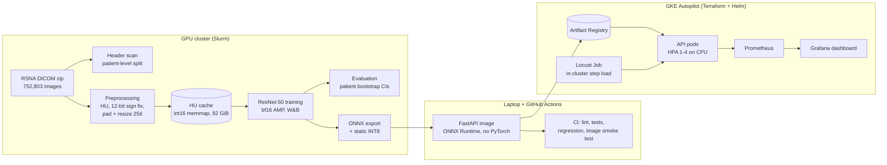
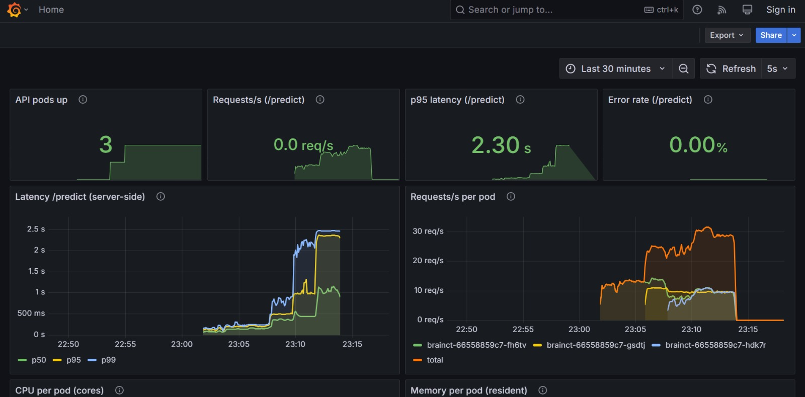

# BrainCT: Intracranial Hemorrhage detection, from DICOM to autoscaled API

[](https://github.com/pratox1112/BrainCT-Hemorrhage-MLOps/actions/workflows/ci.yml)
[](LICENSE)

<p>
  
  
  
  
  
  
  
  
  <br>
  
  
  
  
  
  
  
  
</p>

> **Research use only. Not a medical device and not for clinical decisions.**

An end-to-end ML system for detecting five types of brain hemorrhage on CT slices: a
reproducible data pipeline over 752,803 RSNA DICOMs, a ResNet-50 trained on a GPU cluster,
ONNX export and INT8 quantization, a FastAPI service in a PyTorch-free Docker image, a CI
suite with regression tests, and deployment to **GKE Autopilot** with Terraform, Helm, a
Horizontal Pod Autoscaler, Prometheus and Grafana, load-tested from inside the cluster.

Every number below comes from [`docs/results.md`](docs/results.md), which records how and
where each one was measured.

## Highlights

| | Result |
|---|---|
| **Model quality** | Test macro ROC AUC **0.977** (95% CI 0.973–0.980) over 5 subtypes, on a held-out, **patient-level** test set of 76,573 images from 1,894 patients |
| **Model size** | INT8 ONNX model **24.0 MB**, 3.9× smaller than FP32 (94.0 MB) |
| **Model latency** (laptop CPU, batch 1) | p95 **12.6 ms** INT8 vs 61.7 ms PyTorch FP32 (**4.9× faster**); throughput 117 vs 15.9 img/s at batch 32 |
| **API latency** (laptop, Docker, 1 client) | p50 **23.9 ms**, p95 **38.6 ms** end to end (upload, DICOM decode, preprocessing, inference) |
| **GKE, autoscaled** | Max sustained **24.2 req/s at p95 207 ms**, 0 errors; HPA scaled **1 → 3 pods** under a step load of 1 → 32 concurrent users |
| **GKE, micro-batching** | Under overload on one 2-vCPU pod: **14.7 vs 9.5 req/s (+55%)**, p95 2.5 s vs 4.5 s |
| **Tests** | 420 tests, **86%** coverage of `src/brainct`; regression tests catch a 1-HU change in one window |

## Architecture



The same `preprocess_dicom` function builds the training cache and serves requests, so
training and serving can't drift apart; a test checks that served predictions equal an
offline ONNX run of the same file.

## Results

### Model: test set, evaluated once

ResNet-50 (ImageNet weights), 3-window input (brain 40/80, subdural 80/200, bone 600/2800) at
256 px, 5 epochs, trained in 45 minutes on one A100. Thresholds were chosen on val and
applied unchanged to test; confidence intervals from 1,000 patient-level bootstrap resamples.

| Label | ROC AUC | 95% CI | Average precision | F1 (val threshold) |
|---|---|---|---|---|
| any | 0.9773 | 0.9741–0.9805 | 0.911 | 0.839 |
| epidural | 0.9715 | 0.9537–0.9838 | 0.283 | 0.327 |
| intraparenchymal | 0.9845 | 0.9818–0.9870 | 0.866 | 0.797 |
| intraventricular | 0.9926 | 0.9906–0.9942 | 0.897 | 0.831 |
| subarachnoid | 0.9701 | 0.9646–0.9748 | 0.746 | 0.677 |
| subdural | 0.9648 | 0.9576–0.9711 | 0.753 | 0.695 |
| **macro (5 subtypes)** | **0.9767** | **0.9727–0.9801** | **0.709** | **0.665** |

### Optimization: PyTorch vs ONNX Runtime (laptop, Intel Core Ultra 7 155U, 8 threads)

| Version | p95 batch 1 (ms) | Throughput batch 32 (img/s) | Size | Test macro AUC |
|---|---|---|---|---|
| PyTorch FP32 | 61.7 | 15.9 | – | 0.9767 |
| ONNX Runtime FP32 | 34.4 | 32.0 | 94.0 MB | 0.9767 |
| **ONNX Runtime INT8** | **12.6** | **117.0** | **24.0 MB** | 0.9694–0.9754* |

\* INT8 accuracy depends on the CPU: −0.0013 macro AUC on a Xeon with VNNI instructions,
−0.0073 on an AMD EPYC without them (a known ONNX Runtime u8s8 behaviour). Both measured on
the full test set on the cluster. See `docs/results.md`, Phase 5a.

### Load tests on GKE Autopilot (from inside the cluster)

Locust runs as a Kubernetes Job next to the API, so the numbers measure the service and not a
home internet upload. Step load: 1 → 2 → 4 → 8 → 16 → 32 concurrent users, 2 minutes each.
"Max sustained" = the highest step with p95 at most 2× its 1-user value and under 1% errors
(rule fixed before measuring). Each pod: 2 vCPU, 2 GiB.

| Setup | Max sustained | Peak throughput | Errors |
|---|---|---|---|
| HPA 1–4 pods, batching off | **24.2 req/s** at 4 users (p95 207 ms) | 30.4 req/s (16 users, 3 pods) | 0% |
| 1 pod, batching off | 13.3 req/s at 1 user (p95 89 ms) | 13.3 req/s, falling to 9.5 under overload | 0% |
| 1 pod, batching on | 13.3 req/s at 2 users (p95 175 ms) | **14.7 req/s** at 32 users | 0% |



Pods went from 1 to 3 during the run, and requests spread across them. Micro-batching is
therefore **on for GKE** (`infra/helm/values-gke.yaml`) and off by default elsewhere: on the
laptop it gave no gain.

## Repository layout

```
src/brainct/
  data/            zip reader, header scan, labels, patient split, HU cache build + check
  preprocessing/   DICOM -> HU (with the 12-bit sign fix), windows, model input
  training/        dataset, ResNet-50, train loop (bf16, resume), evaluation, metrics
  optimization/    ONNX export, INT8 quantization, ONNX evaluation, latency benchmark
  serving/         FastAPI app, micro-batcher, settings, async load-test client
tests/             unit, API and regression tests (synthetic DICOMs; no data needed in CI)
jobs/              Slurm scripts for the cluster steps
serving/           API Dockerfile + exported requirements
infra/terraform/   GKE Autopilot cluster, Artifact Registry, node IAM
infra/helm/        API chart + values for Docker Desktop and GKE
monitoring/        Prometheus + Grafana (Kustomize), dashboard as code
load_tests/        Locust step load, its image and the in-cluster Job
scripts/           CI stand-in assets, regression expectations, load-test summary
docs/              results.md (every measured number), decisions.md
legacy/            the original 2025 research notebooks (reference only)
```

## How to run it

Python 3.11 and [uv](https://docs.astral.sh/uv/). The data and weights are not in this
repository (see [Data and licence](#data-and-licence)).

**Set up and test (laptop)**
```bash
uv sync --all-extras --group loadtest
uv run ruff check . && uv run pytest
```

**Data, cache and training (GPU cluster, Slurm)**: download with the Kaggle API, then
```bash
sbatch jobs/extract_headers.sh      # header scan -> image/patient table
sbatch jobs/make_split.sh           # patient-level 80/10/10 split, seed 2026
sbatch jobs/build_cache.sh          # DICOM -> HU int16 cache [N, 256, 256]
sbatch jobs/check_cache.sh          # cache equals fresh preprocessing
bash   jobs/train_chain.sh 2 --set run_id=resnet50_baseline   # chained, resumable jobs
sbatch jobs/evaluate.sh resnet50_baseline val                 # then: ... test (once)
sbatch jobs/optimize.sh             # ONNX export, INT8 calibration, accuracy check
```

**Benchmark and serve (laptop)**, with the model files in `artifacts/resnet50_baseline/`:
```bash
uv run python -m brainct.optimization.benchmark
docker build -f serving/Dockerfile -t brainct-api:0.1.0 .
docker run --rm -p 8080:8000 brainct-api:0.1.0      # http://127.0.0.1:8080/docs
```

**Deploy to GKE and load-test** (costs money while it runs; always tear down)
```bash
terraform -chdir=infra/terraform apply
# push the API and load-test images to the registry from `terraform output`, then:
helm install brainct infra/helm/brainct -f infra/helm/values-gke.yaml \
    --set image.repository=<registry>/brainct-api --set service.type=ClusterIP
kubectl apply -k monitoring
kubectl apply -f load_tests/job.yaml        # with the image set to the registry path
uv run python scripts/summarize_locust.py load_tests/results/<run>/run_requests.csv
helm uninstall brainct && kubectl delete -k monitoring
terraform -chdir=infra/terraform destroy
```

## Known limitations

- **Single-slice input.** Each slice is classified on its own, without neighbouring slices.
  Top RSNA solutions use slice context; it would most help the weakest subtypes here,
  **subdural (AUC 0.965) and subarachnoid (0.970)**, which are thin or diffuse bleeds.
- **Epidural is rare** (0.45% of images, 31 test patients): high AUC (0.972) but low average
  precision (0.283) and F1 (0.327), so many false alarms per true detection, and the widest
  confidence interval.
- **One data source.** All images come from the RSNA 2019 dataset; no external validation.
- **Not comparable to the Kaggle leaderboard:** a different, patient-level split and metric.
- **CPU-only serving**, and INT8 accuracy depends on the CPU's instruction set (see above).
- **Load generator:** one Locust process with 1 CPU. Its CPU use during the GKE runs was not
  recorded, so whether it limited the highest steps is not known.
- **No drift monitoring** yet (e.g. input-intensity and prediction distributions against a
  training reference); a natural next step.

## Data and licence

- Data: [RSNA Intracranial Hemorrhage Detection](https://www.kaggle.com/competitions/rsna-intracranial-hemorrhage-detection)
  (Kaggle, 2019). Its competition rules apply; **no images, cache files or trained weights
  are distributed with the current code**. CI uses synthetic DICOMs and a stand-in model.
- Code: [MIT](LICENSE). The licence covers the source code only.
- The original 2025 research notebooks (Pratosh Karthikeyan and Nirmal) are in
  [`legacy/`](legacy/README.md); their numbers are not comparable to the results above.

Design choices and the alternatives considered are in [`docs/decisions.md`](docs/decisions.md).
